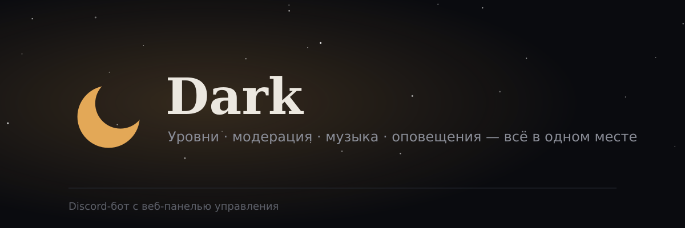

<p align="center">
  
</p>

<p align="center">
  
  
  
  
</p>

# Dark

Discord-бот с веб-панелью. Команд мало, возможностей много: всё спрятано в подкоманды,
а то же самое можно настроить в браузере после входа через Discord.

- **Профиль-карточка и таблица лидеров** — красивые изображения: уровень, место на сервере, обе валюты, время в голосовых; в топе переключатель Общий / Голос
- **Один уровень** от сообщений и времени в голосе: у чата и голоса свои настройки, голосовой опыт ведёт отдельный рейтинг. **Роли за уровни** настраиваются в панели
- **Возвращение участника:** если человек вышел и зашёл снова, он получает обратно роли и никнейм, а незаконченный таймаут продолжается. Уровень, опыт, монеты, кристаллы, покупки и предупреждения при выходе не удаляются вовсе. Роли с правами модератора, роли выше роли бота, бустерские роли и роли ботов не возвращаются; после бана участник возвращается без ролей. Срок хранения (по умолчанию 365 дней) и переключатели — в панели на странице «Приветствие». Нужно, чтобы у бота было право «Управлять ролями» и его роль стояла выше возвращаемых
- **Управление личной голосовой комнатой (как TempVoice):** в панели на странице «Врем. голосовые» бот размещает в выбранном канале сообщение с кнопками-иконками (что делает каждая, написано в самом сообщении): ✏️ название и лимит, 🔒 доступ (открыть, закрыть, скрыть), 🤝 доверять, 🙅 не доверять, 📨 пригласить (бот напишет в личные сообщения), 👢 выгнать, 🌍 регион, ⛔ забанить, ✅ разбанить, 🗑️ удалить. Кнопки действуют на комнату, в которой сидит нажавший (или на его собственную); чужую комнату трогать нельзя. То же есть командой `/voice` (`name`, `limit`, `access`, `trust`, `invite`, `kick`, `ban`, `region`, `transfer`, `claim` — забрать комнату, если владелец вышел, `info`, `delete`, `panel`). Создателю комнаты бот сразу выдаёт право входа, поэтому закрыв комнату, он не потеряет к ней доступ. Нужны права бота «Управлять каналами», «Управлять ролями» и «Перемещать участников»
- **Вебхуки через бота:** `/webhook create` создаёт вебхук в канале (имя, аватарка) и присылает ссылку только вам; `list`, `delete` (только созданные этим ботом, вебхук логов не трогает), `send` — сообщение от имени вебхука без @everyone. Нужно право «Управлять вебхуками» у вас и у бота; то же — в веб-панели на странице «Вебхуки» (создать в выбранном канале, показать ссылку, отправить сообщение, удалить)
- **Бета-режим:** на странице «Функции» у каждого сервера есть переключатель «Бета-функции». Новые, ещё не проверенные возможности работают только там, где он включён, и помечены тегом «бета» в меню и в списке функций. Чтобы выпустить функцию для всех, в `bot/utils/features.js` убирается `beta: true`. Сейчас в бете: вебхуки
- **Вид панели:** тёмная и светлая темы (кнопка в меню, выбор запоминается в браузере); меню слева — узкая колонка с иконками, которая выезжает при наведении и подписывает каждый раздел (что в нём настраивается), кнопка с булавкой закрепляет его открытым; на телефоне меню — полоса сверху
- **Скорость:** страницы панели грузят данные Discord и базы параллельно, одинаковые одновременные запросы к Discord объединяются в один, шрифты кэшируются на год, события бота (голос, вход/выход, модерация) берут настройки из кэша, добавлены индексы для сортировок /top
- **Панель вебхуков в Discord:** `/webhook panel` (или кнопка на странице «Вебхуки») размещает сообщение с кнопками-иконками, как у личных комнат: ➕ создать, 📋 список, ✉️ отправить, ✏️ изменить, 🗑️ удалить. Все ответы видны только нажавшему, право «Управлять вебхуками» проверяется на каждом шаге, аватарка по ссылке скачивается с защитой от внутренних адресов
- **Голосования с таймером:** `/poll` с параметром `duration` (например `1h`) сам подсчитывает реакции и публикует итоги; без срока голосование бессрочное
- **Очистка чата:** `/mod clear` умеет удалять только сообщения участника, ботов, со ссылками, с файлами или с заданным текстом
- **Объявление о новом уровне в чате голосового канала:** если участник сидит в голосовом канале, поздравление приходит в чат этого канала (не в AFK-канал); если у бота нет прав или чат закрыт, сообщение уходит в обычный канал объявлений. Включается переключателем в «Уровнях»; боту нужны права «Просмотр канала» и «Отправлять сообщения» в голосовых каналах
- **Две валюты:** монеты (за сообщения, минуты в голосе, ежедневную награду) и кристаллы (за новые уровни); названия и награды настраиваются в панели
- **Экономика** — ежедневная награда, переводы
- **Ручное изменение уровня** — в веб-панели («Уровни» → «Изменить уровень участника», или нажмите на уровень участника в лидерборде): добавить, убавить или задать точный уровень; роли за уровни обновляются сразу
- **Функции** — страница «Функции» в веб-панели: любую часть бота (уровни, экономику, магазин, музыку, автомодерацию, приветствие, роли по реакциям, свои команды, временные голосовые, оповещения, жалобы) можно включить и выключить; настройки и данные при этом сохраняются
- **Музыка** — YouTube, SoundCloud (треки, плейлисты, поиск `sc: название`; работает через yt-dlp), ссылки Spotify и Apple Music (названия берутся из ссылки, звук ищется на YouTube); бот сам выходит из голосового после 5 минут простоя
- **Модерация и автомодерация** (в духе YAGPDB) — дела с номерами, предупреждения с автоматическим наказанием (3 предупреждения → мут, 5 → бан и т. д.) и сроком действия, мут и бан на срок (`30m`, `2h`, `7d`; временный бан снимается сам), личные уведомления участнику, заметки и история, `clear` по участнику, `slowmode` и `lock`; автомодерация: запрещённые слова, приглашения и любые ссылки (с белым списком сайтов), упоминания, заглавные буквы, эмодзи, повторы и спам, с наказанием (удалить / предупредить / замутить) и исключениями по каналам и ролям; журнал, жалобы на сообщения
- **Логи сервера** — форум с темами по видам событий (сообщения, участники, наказания, голосовые, файлы, сервер, роли, каналы); создаётся одной кнопкой в панели («Логи сервера»), записи идут через вебхук с аватаркой бота; по журналу аудита показывается, кто сделал изменение (нужно право «Просмотр журнала аудита» — оно есть в ссылке-приглашении), в том числе кто выгнал участника
- **Резерв на 14 дней** — если бота убрали с сервера (например, случайно), все настройки, уровни, магазин и предупреждения хранятся 14 дней; добавьте бота обратно — всё продолжит работать. Через 14 дней данные сервера удаляются. После возврата зайдите на «Логи сервера» и нажмите «Сохранить»: бот создаст новый вебхук и использует прежние темы
- **Сервер** — роли по реакциям, автороль, приветствия, временные голосовые каналы, свои команды
- **Оповещения** о видео на YouTube и стримах Twitch
- **Веб-панель** — тёмная тема, вход через Discord, HTTPS

## Команды

Всего 6 команд. Наберите `/`, и Discord покажет подкоманды.

**Для участников**

| Команда | Действие |
|---|---|
| `/profile` · `/top` | Карточка профиля и таблица лидеров (изображения) |
| `/daily` · `/balance` · `/pay` | Награда раз в сутки (растёт при серии дней подряд), баланс и перевод монет или кристаллов |
| `/shop` | Магазин сервера: роли и предметы за монеты или кристаллы; товары правятся в веб-панели |
| `/play` | Музыка в голосовом канале. Всё остальное кнопками на панели: назад, пауза, пропуск, очередь, стоп, громкость |
| `/help` | Список команд |
| Меню сообщения → **Report message** | Жалоба модераторам |

**Для администрации**

| Команда | Действие |
|---|---|
| `/mod` | `warn` `unwarn` `warnings` `clearwarns` `mute` `unmute` `kick` `ban` `unban` `clear` `note` `case` `history` `reason` `slowmode` `lock` `unlock` |

Всё остальное настраивается в веб-панели, команд для этого нет: каналы логов и жалоб, приветствие и автороль,
уровни и валюта, автомодерация, роли по реакциям, свои команды и префикс, временные голосовые, оповещения.

## Быстрый старт

### 1. Приложение в Discord

1. [Developer Portal](https://discord.com/developers/applications) → **New Application**.
2. **Bot** → **Reset Token** → это `DISCORD_TOKEN`.
3. В **Privileged Gateway Intents** включите **Server Members** и **Message Content**.
   Без них бот не запустится (`Used disallowed intents`).
4. **OAuth2** → скопируйте **Client ID** и **Client Secret**.
5. **OAuth2 → Redirects** → добавьте `https://ВАШ_ДОМЕН:8843/auth/callback`.
6. Пригласите бота (scopes `bot` и `applications.commands`):
   ```
   https://discord.com/oauth2/authorize?client_id=ВАШ_CLIENT_ID&scope=bot%20applications.commands&permissions=1100336983254
   ```

Бот просит только нужные права (не «Администратор»): просмотр и отправка сообщений, вложения, управление сообщениями, ролями, каналами и вебхуками, кик, бан, тайм-аут, голосовые каналы. Та же ссылка стоит на кнопке приглашения в веб-панели. Чтобы кнопка «Добавить приложение» в профиле бота давала те же права, укажите их в Developer Portal → **Installation** → **Default Install Settings** (scopes `bot`, `applications.commands`, те же права).

Роль бота должна стоять выше ролей, которыми он управляет.

Для форума логов боту нужны права «Управлять каналами», «Управлять вебхуками» и «Просмотр журнала аудита» (они уже есть в ссылке-приглашении). Если бот был добавлен раньше — выдайте их его роли вручную.

### 2. Сервер (Ubuntu)

```bash
sudo apt update
sudo apt install -y git ffmpeg python3 build-essential nginx certbot
```

Node.js 20 или новее:

```bash
curl -fsSL https://deb.nodesource.com/setup_22.x | sudo -E bash -
sudo apt install -y nodejs
```

yt-dlp (нужен для музыки):

```bash
sudo curl -L https://github.com/yt-dlp/yt-dlp/releases/latest/download/yt-dlp -o /usr/local/bin/yt-dlp
sudo chmod a+rx /usr/local/bin/yt-dlp
```

Проект:

```bash
cd /opt
git clone git@github.com:ВАШ_АККАУНТ/ВАШ_РЕПОЗИТОРИЙ.git dark-bot
cd dark-bot
npm install
cp .env.example .env
nano .env
npm run deploy-commands
```

Запуск:

```bash
sudo npm install -g pm2
pm2 start ecosystem.config.js
pm2 save
pm2 startup
```

### 3. Файл `.env`

```env
DISCORD_TOKEN=
DISCORD_CLIENT_ID=
DISCORD_CLIENT_SECRET=

# ID вашего сервера: deploy-commands очистит на нём старые серверные копии команд.
DEV_GUILD_ID=

WEB_PORT=3000
WEB_BASE_URL=https://ВАШ_ДОМЕН:8843
SESSION_SECRET=      # ОБЯЗАТЕЛЬНО, от 24 символов: openssl rand -hex 32 (без него веб-панель не запустится)
BOT_OWNER_IDS=       # ваш Discord ID

DATABASE_PATH=./data/dark.sqlite

# необязательно
YOUTUBE_API_KEY=
TWITCH_CLIENT_ID=
TWITCH_CLIENT_SECRET=
ALERT_POLL_INTERVAL_MINUTES=5
```

- `WEB_PORT` — внутренний порт панели. Не ставьте туда 8843 или 8880: их занимает nginx.
- `WEB_BASE_URL` должен начинаться с `https://`, иначе вход через Discord не сохранит сессию.
- После правки `.env`: `pm2 restart all --update-env`.

### 4. HTTPS на нестандартных портах

Порты 80 и 443 не нужны: **8843** отдаёт HTTPS, **8880** перенаправляет на него.

```
Браузер → https:8843 → nginx → панель (localhost:3000)
```

<details>
<summary>Сертификат Let's Encrypt через DNS (DuckDNS или другой домен)</summary>

```bash
sudo certbot certonly --manual --preferred-challenges dns -d ВАШ_ДОМЕН
```

Сертификат ляжет в `/etc/letsencrypt/live/ВАШ_ДОМЕН/`. Для DuckDNS TXT-запись ставится запросом
`https://www.duckdns.org/update?domains=ИМЯ&token=ТОКЕН&txt=ЗНАЧЕНИЕ` — его можно вынести в
`--manual-auth-hook` и `--manual-cleanup-hook`, тогда продление пройдёт без участия человека.
Токен DuckDNS секретный: если он попал в чат или скриншот, перевыпустите его на сайте.

</details>

<details>
<summary>Конфиг nginx</summary>

Файл `/etc/nginx/conf.d/dark-bot.conf`:

```nginx
server {
    listen 8880;
    server_name ВАШ_ДОМЕН;
    return 301 https://$host:8843$request_uri;
}

server {
    listen 8843 ssl;
    server_name ВАШ_ДОМЕН;

    ssl_certificate     /etc/letsencrypt/live/ВАШ_ДОМЕН/fullchain.pem;
    ssl_certificate_key /etc/letsencrypt/live/ВАШ_ДОМЕН/privkey.pem;

    client_max_body_size 25m;   # для импорта уровней

    location / {
        proxy_pass http://localhost:3000;
        proxy_http_version 1.1;
        proxy_set_header Upgrade $http_upgrade;
        proxy_set_header Connection 'upgrade';
        proxy_set_header Host $http_host;
        proxy_set_header X-Real-IP $remote_addr;
        proxy_set_header X-Forwarded-For $proxy_add_x_forwarded_for;
        proxy_set_header X-Forwarded-Proto $scheme;
    }
}
```

```bash
sudo nginx -t && sudo systemctl restart nginx
sudo ufw allow 8880/tcp    # если включён ufw
sudo ufw allow 8843/tcp
```

</details>

Панель: **https://ВАШ_ДОМЕН:8843**

## Обновление через GitHub

Код попадает на сервер только через GitHub.

1. В GitHub Desktop проверьте, что в списке изменений есть все файлы (в том числе `package.json`).
2. **Commit to main**, затем отдельно **Push origin**.
3. Убедитесь на github.com, что файлы обновились.
4. На сервере:

```bash
cd /opt/dark-bot
git pull
npm install
pm2 restart dark-bot
```

**Бот и панель — один процесс (`dark-bot`).** Панель запускается внутри бота, поэтому отдельный процесс `dark-web` больше не нужен. Если он у вас остался с прошлых версий, один раз выполните `pm2 delete dark-web` (до перезапуска `dark-bot`, чтобы освободить порт) и `pm2 save`. `WEB_ENABLED=false` в `.env` отключает панель, если она вам не нужна.

`npm run deploy-commands` нужен только если менялся набор команд, подкоманд или их названий и параметров (например, русское название пункта «Пожаловаться» и скрытие команд в ЛС).

Если `git pull` отказывается из-за `package.json` или `package-lock.json`:

```bash
git checkout -- package.json
rm -f package-lock.json
git pull
```

Чтобы это не повторялось, добавьте `package-lock.json` в `.gitignore`.

## Веб-панель

Вход через Discord. Видны серверы, где у вас есть право управления.

Разделы: обзор, уровни (настройки чата и голоса отдельно, с импортом и экспортом), экономика (валюты), роли за уровни, лидерборд, модерация, автомодерация, приветствие и автороль,
роли по реакциям, свои команды, временные голосовые, оповещения, логи сервера.

Панель и бот используют одну базу SQLite, поэтому настройки применяются сразу, без перезапуска.

## Оповещения YouTube и Twitch

- YouTube: ключ YouTube Data API v3 из Google Cloud Console → `YOUTUBE_API_KEY`. Канал указывается по ID вида `UCxxxxxxxxxxxxxxxxxxxxxx` (регистр важен). Проверка идёт через список загрузок канала и почти не расходует дневную квоту.
- Twitch: приложение на dev.twitch.tv/console → `TWITCH_CLIENT_ID` и `TWITCH_CLIENT_SECRET`.

Без ключей раздел «Оповещения» в панели сообщит, что интеграция не настроена. Остальной бот работает.

## Если что-то не работает

| Симптом | Что делать |
|---|---|
| Бот не в сети, в логе `Used disallowed intents` | Включить Server Members и Message Content в Developer Portal, затем `pm2 restart dark-bot` |
| Команд нет в списке | `npm run deploy-commands`, перезапустить Discord (Ctrl+R), проверить scope `applications.commands` у приглашения |
| Команды задвоились или остались старые | `npm run deploy-commands`: он регистрирует команды глобально и чистит серверные копии. Затем Ctrl+R в Discord |
| Изменений нет на сервере | Закоммичено → Push origin → видно на github.com → `git pull` → `pm2 restart` |
| `Cannot find module …` или `X.init is not a function` | `pm2 stop all && rm -rf node_modules && npm ci && pm2 restart all` (`package-lock.json` теперь лежит в git и фиксирует версии) |
| Музыка: «Не удалось воспроизвести … возрастное ограничение / 403 / не бот» | Бот пишет причину в чат. Для YouTube: `sudo yt-dlp -U`, в `.env` добавить `YTDLP_EXTRA_ARGS=--js-runtimes node`; для возрастных видео и проверки «не бот» — файл cookies и `YTDLP_COOKIES=/путь/cookies.txt` (см. `.env.example`), затем `pm2 restart dark-bot --update-env` |
| Музыка: «Не удалось воспроизвести» | Проверить `yt-dlp --version`, `ffmpeg -version`; в `package.json` должен быть `@discordjs/opus`; обновить `sudo yt-dlp -U`; смотреть `pm2 logs dark-bot --lines 60` |
| Панель не открывается | `sudo nginx -t`; `WEB_PORT` должен быть 3000; порты: `sudo ss -tlnp \| grep -E '8843\|8880\|3000'` |
| `redirect_uri` при входе | Redirect в Developer Portal должен точно совпадать с `WEB_BASE_URL` + `/auth/callback` |

## Ограничения

- Spotify, Apple Music и Яндекс.Музыка напрямую не играют: по ссылке Spotify или Apple Music бот берёт название трека и ищет звук на YouTube.
- Оповещения работают опросом раз в `ALERT_POLL_INTERVAL_MINUTES` минут.
- Опыт за голосовой канал не начисляется, если вы одни в канале, заглушены или сидите в AFK-канале.

## Проверка перед выпуском

В папке `test_harness/` лежат тесты на имитации Discord (без реального токена):

```bash
node test_harness/run.js           # команды
node test_harness/run_events.js    # события
node test_harness/run_music.js     # музыкальная панель
```

## Релиз и бета: ветки main и beta

В репозитории две ветки: **main** — проверенная версия, **beta** — то, что ещё тестируется.

**Как работать в GitHub Desktop**
1. Один раз: *Current Branch → New Branch*, имя `beta`, основа `main`, затем *Publish branch*.
2. Новые изменения распаковывайте и коммитьте, когда выбрана ветка **beta** (вверху слева), затем *Push origin*.
3. Когда beta проверена: переключитесь на **main**, *Branch → Merge into current branch…*, выберите `beta`, затем *Push origin*.

**Как обновлять сервер** (по одной команде)

```bash
cd /opt/Dark-Bot
sh scripts/update.sh beta    # поставить бету
sh scripts/update.sh main    # вернуться на релиз
```

Скрипт сам скачивает ветку, ставит зависимости (`npm ci`) и перезапускает `dark-bot`. Без аргумента обновляет ту ветку, на которой сервер стоит сейчас.

**Бета и релиз одновременно (по желанию).** Для этого нужен второй бот: отдельное приложение в Discord Developer Portal со своим токеном, вторая копия проекта (`git clone -b beta … /opt/Dark-Bot-beta`) со своим `.env` (другой `DISCORD_TOKEN`, `WEB_PORT=3001`, `DATABASE_PATH=./data/beta.sqlite`), запуск `pm2 start bot/index.js --name dark-beta` и отдельный адрес для панели (nginx и redirect в приложении Discord). Обновлять его: `PM2_NAME=dark-beta sh scripts/update.sh beta`.

**Бета-функции привязаны к ветке.** Бот сам определяет, какая ветка запущена (читает `.git/HEAD`): на `beta` — бета-версия, на любой другой — релиз. Функции с пометкой `beta: true` в `bot/utils/features.js` существуют только в бета-версии: на релизе они выключены, их команды отвечают «функция бета-версии», а в панели вместо переключателя «Бета-функции» стоит пояснение. В бета-версии рядом с названием «Dark» в меню горизонтальный значок «бета», а администратор сервера включает бета-функции переключателем в разделе «Функции».

Чтобы выпустить бета-функцию для всех: удалите у неё `beta: true` и влейте `beta` в `main`.

Если папки `.git` нет (например, в Docker), версию задаёт `BOT_CHANNEL=beta` или `BOT_CHANNEL=release` в `.env`.

## Структура

```
assets/             баннер и логотип
bot/
  commands/         слэш-команды по категориям
  events/           события Discord
  modules/          уровни, automod, rankCard, музыка, оповещения
  utils/            эмбеды, права, журнал модерации, планировщик (scheduler.js)
  assets/fonts/     шрифты для карточки профиля
db/                 модели Sequelize; migrations/ — изменения схемы (umzug)
web/                панель: routes/dashboard/ (по файлу на страницу), views (EJS), public
ecosystem.config.js
Dockerfile, docker-compose.yml
```

## Изменения в базе данных

Схема меняется миграциями: файлы `db/migrations/NNNN_название.js` (каждый экспортирует `{ name, up({ sequelize }) }`) выполняются по одному разу по порядку, выполненные записываются в таблицу `schema_migrations`. Новая колонка, индекс или правка данных — это **новый** файл со следующим номером (выпущенные файлы не редактируют) плюс поле в модели. Новая таблица — достаточно модели, её создаст `sync()`.

## Таймеры

Розыгрыши, напоминания, опросы и временные баны идут через один планировщик (`bot/utils/scheduler.js`): он спит ровно до ближайшего срока и просыпается, когда создаётся новое событие. Раньше каждый тип опрашивал базу каждые 15–30 секунд.

## Лицензия

MIT

## Бонусы каналов

В панели есть страница **«Бонусы каналов»**: в выбранных каналах (или во всей категории) опыт и монеты начисляются с множителем. Например, ×2 в канале общения, ×0,5 в флудилке и ×0 там, где начислять не нужно. Работает для текстовых и голосовых каналов, ветки форумов и тредов берут бонус родительского канала. Бонус категории действует на все её каналы, а свой бонус у канала важнее. Множитель считается от обычных значений со страницы «Уровни».

## Модерация подробнее

**Сроки.** Везде, где нужен срок, пишите `30m` (минуты), `2h` (часы), `7d` (дни), `1w` (недели) или по-русски `30м`, `2ч`, `7д`. Можно складывать: `1h30m`. Просто число — минуты. Мут — до 28 дней (ограничение Discord); бан можно на любой срок, через `/mod ban duration:7d`. Бот каждые 30 секунд проверяет, не пора ли снять бан.

**Предупреждения.** На странице «Модерация» → «Правила наказаний» задаётся, что бот делает при определённом числе действующих предупреждений, например: 3 → мут на 60 минут, 5 → бан на сутки. Здесь же можно включить сгорание предупреждений через N дней, обязательную причину и личные уведомления участнику.

**Дела.** Каждое наказание получает номер: `/mod case 12` покажет дело, `/mod history @участник` — всю историю с заметками, `/mod reason 12 текст` исправит причину. `/mod note` добавляет приватную заметку (участник о ней не узнает).

**Права бота.** Для мута, кика и бана боту нужны права «Исключение участников», «Блокировка участников» и «Модерировать участников», а его роль должна стоять выше ролей наказуемых. Для `lock` и `slowmode` нужно «Управление каналами».

## Баланс и дюп валюты

Монеты, кристаллы и опыт меняются одним SQL-запросом на добавление/списание (`bot/modules/wallet.js`), поэтому одновременные /pay, покупки, /daily, опыт и действия из панели не могут потерять или удвоить деньги. Проверяется тестом `test_harness/run_wallet.js`. Подробности — в `CHANGELOG.md`.

## Шифрование токена вебхука логов
Токен хранится в базе в зашифрованном виде (AES-256-GCM, `db/crypto.js`). Ключ — `DATA_KEY` в `.env`, если не задан — `SESSION_SECRET`. Если ключ изменить, токен не прочитается: форум логов нужно подключить в панели заново.

## Безопасность веб-панели

- **Секрет сессии обязателен:** без `SESSION_SECRET` (от 24 символов) панель не запускается. После смены секрета все администраторы входят заново.
- **Защита от подделки запросов:** любое изменение принимается только с этого же сайта (проверка `Origin`/`Referer` + cookie `SameSite=Lax`); выход из панели — только кнопкой (POST).
- **Права проверяются заново:** список серверов администратора обновляется из Discord (не чаще раза в 20 секунд); потерял роль — потерял доступ. Если Discord не подтверждает права больше часа, нужно войти заново.
- **Ограничения частоты:** вход (30 попыток за 10 минут с одного адреса), любые изменения в панели (120 в минуту), действия с вебхуками (10 в минуту).
- **Аватарки вебхуков по ссылке:** только `https`, без редиректов, до 8 МБ; адрес проверяется в момент подключения (внутренние сети и подмена DNS отклоняются).
- **Журнал действий панели:** в логе `pm2 logs dark-bot` для каждого изменения записываются пользователь, адрес и результат (без содержимого форм). Ссылки вебхуков и токены в логах скрываются.
- **Файлы данных:** папка `data/` и базы доступны только владельцу (права 700/600). Не публикуйте её и не кладите `.env` в репозиторий.
- **Вход через Discord с проверкой `state`:** случайное значение сохраняется в сессии и проверяется при возврате, поэтому войти «чужим» входом по подложной ссылке нельзя.
- **Заголовки и кэш:** HSTS на https, запрет показа в рамках и чужих источников, запрет камеры/микрофона/геолокации; страницы панели (ссылки вебхуков, списки участников) не кэшируются ни браузером, ни прокси.
- **Музыка:** всё, что ввёл пользователь, передаётся в yt-dlp после `--`, поэтому текст запроса не может стать параметром запуска.
- **Баланс и уровень из панели** меняются одной операцией, поэтому одновременные начисления бота не теряются.
